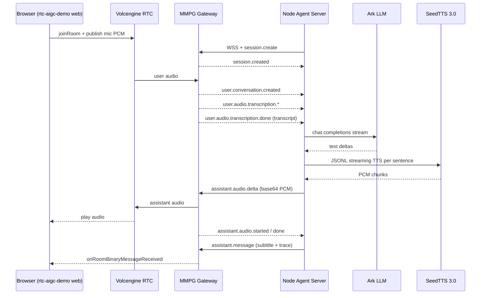

# 架构与会话协议

## 数据流



## 服务端组件

| 组件                               | 职责                                                   |
| ---------------------------------- | ------------------------------------------------------ |
| `server/lib/app.js`                | HTTP API、RTC Token、call 生命周期、MMPG 会话编排      |
| `server/lib/bot-config.js`         | `AibotxQuery` 查询 Bot，读取 ASR/音频默认值            |
| `server/lib/mmpg-client.js`        | WebSocket 连接、签名、事件收发、等待 `session.created` |
| `server/lib/turn-controller.js`    | ASR 聚合、LLM 轮次、分句 TTS、`resp_id`、打断、Trace   |
| `server/lib/ark-agent.js`          | Ark Chat Completions 流式调用                          |
| `server/lib/tts-client.js`         | SeedTTS 3.0 JSONL 流式 PCM + 2.0 兼容                   |
| `server/lib/inline-tags.js`        | 官方标签清单、系统提示词注入、字幕标签清洗             |
| `server/lib/sentence-segmenter.js` | 中英文流式分句，降低首包延迟                           |

## 与官方 Gateway 接入步骤的对应关系

本项目按官方文档的 **Custom Agent via Gateway / MMPG** 模式实现，不是
`StartVoiceChat` 托管模式。浏览器只负责 RTC 音视频；业务服务端通过 AK/SK
签名连接 MMPG，自行编排 ASR、LLM、TTS 和音频回传。

| 官方步骤                   | 本项目实现                                                                         |
| -------------------------- | ---------------------------------------------------------------------------------- |
| 准备工作                   | `.env.local` 配置 RTC、AK/SK、ASR、Ark、TTS；BotId 是控制台配置扩展                |
| 步骤 1：客户端音视频通话   | `web/src/lib/RtcClient.ts` 进房，自动发布麦克风并订阅 AI 音频                      |
| 步骤 2：建立 WebSocket     | `server/lib/mmpg-client.js` + `server/lib/sign.js`，使用 AK/SK 签名 WSS            |
| 步骤 3：创建并初始化会话   | `server/lib/app.js` 的 `buildMmpgSession`，发送 `session.create` 并等待确认        |
| 步骤 4：处理事件并回传音频 | `server/lib/turn-controller.js`：ASR done -> Ark -> TTS -> `assistant.audio.delta` |
| 步骤 5：结束会话           | `/session/stop` -> `session.close`；客户端 `leaveRoom` 并销毁 RTC 引擎             |
| 用户打断                   | `assistant.audio.cancel` + 递增 `resp_id`，并中止当前 LLM/TTS 任务                 |
| 欢迎语                     | 客户端 `client.ready` 后，由服务端生成 TTS 并通过 `assistant.audio.delta` 发送     |
| 自定义消息                 | 服务端 `assistant.message`；客户端 `sendUserBinaryMessage` -> `user.message`       |

需要明确标注的差异：

- **BotId / `AibotxQuery`**：官方 Gateway 模式本身不要求 BotId。本 Demo 用它读取控制台
  Bot 的 ASR/音频默认值，BotId 不参与 MMPG 协议鉴权。
- **ASR 凭证层级**：官方页面示例使用 `ProviderParams.Credential`；2026-11-24
  当前网关实测拒绝该包装，本 Demo 使用 `yarn probe` 验证通过的 `ApiKey` schema。
- **字幕路径**：关闭平台 RTS 字幕（`DisableRTSSubtitle: true`），通过
  `assistant.message` 发送 `subv` 自定义字幕。
- **演示接口**：`/getScenes`、`/session/start`、`/session/stop` 是 Demo 的 RTC Token
  和会话代理，不属于 Gateway 协议本身。

## Bot 与 ASR 参数

BotId 只用于 `AibotxQuery`。查询结果中的 `Config.ASRConfig.ProviderParams`、`Config.AudioConfig` 会作为默认值，但最终发给 MMPG 的 ASR 结构必须是：

```json
{
  "ASRConfig": {
    "Provider": "volcano",
    "ProviderParams": {
      "Mode": "bigmodel",
      "ApiKey": "<ASR_API_KEY>",
      "ApiResourceId": "volc.bigasr.sauc.duration",
      "StreamMode": 0
    }
  }
}
```

官方页面示例使用 `ProviderParams.Credential`（AppId / AccessToken / ApiResourceId）。但 2026-11-24 用当前网关实测时，`session.create` 会拒绝该包装；本 Demo 使用上面 `yarn probe` 已验证通过的 `ApiKey` schema。

当前网关**不接受**在 `ProviderParams` 内再包一层 `Credential`：

```json
{
  "ProviderParams": {
    "Credential": {
      "ApiResourceId": "..."
    }
  }
}
```

如果使用 2.0 小时版/流式版，请把 `ASR_RESOURCE_ID` 改成对应资源 ID。`ASR_RESOURCE_ID` 优先级高于 Bot 中的 `ApiResourceId`。

## 自定义消息

### 服务端 -> 客户端

服务端通过 MMPG 发送 `assistant.message`：

```json
{
  "event_id": "event_xxx",
  "type": "assistant.message",
  "payload": "{\"v\":1,\"type\":\"trace\",\"value\":{\"stage\":\"llm.done\"}}"
}
```

`payload` 是字符串。前端收到的 RTC 二进制消息实际为：

```text
cmsg TLV + 普通 JSON（可能被平台再包一层双引号）
```

`web/src/utils/mmpg.ts` 同时兼容：

- 直接 UTF-8 JSON
- Base64 JSON
- `cmsg` TLV
- `cmsg` + 双层引号 JSON
- 旧版 `conv` / `subv` / `tool` / `func` / `ctrl` TLV

### 客户端 -> 服务端

客户端调用 `sendUserBinaryMessage` 时，必须使用 `cmsg` TLV 包装普通 JSON：

```ts
string2tlv(JSON.stringify({ type: 'client.ready', value: { ... } }), 'cmsg')
```

实测结论：

- raw JSON 不会被网关转发为 `user.message`
- `cmsg` + 普通 JSON：服务端收到普通 JSON 字符串
- `cmsg` + 二次 `JSON.stringify`：服务端收到带双引号的字符串

因此 Demo 收敛为只发送 `cmsg` + 普通 JSON，见 `web/src/utils/mmpg.ts` 的 `encodeMmpgMessage`。

## 轮次与打断

- 每次用户最终识别文本触发一个新 turn，`resp_id` 递增。
- LLM 流式文本先按标点分句，再逐句请求 TTS。
- 每句 TTS 的 PCM 通过 `assistant.audio.delta` 发送，最后一个包 `done=true`。
- TTS 请求保留 `[happy]`、`[soft]` 等内联情绪标签；字幕和历史消息使用
  `stripInlineTags()` 去掉标签。
- 用户再次开始说话（`user.audio.transcription.started`）时：
  1. 取消当前 turn 的 AbortController
  2. 清空待合成队列
  3. 发送 `assistant.audio.cancel`
  4. `resp_id` 再递增，后续音频使用新 ID
  5. Trace 记录 `barge_in`
- 客户端点击打断时发送 `client.interrupt`，服务端同样走 `cancelCurrent`。

## 会话生命周期

1. `/getScenes` 创建页面级 Session。
2. `/session/start` 创建 call，生成：
   - 独立 `roomId`
   - 独立 `userId`
   - 独立 `agentUserId`
   - 服务端签发的 RTC Token
3. 服务端连接 MMPG，发送 `session.create`。
4. 前端进房、上报 `client.ready`。
5. 服务端收到 `client.ready` 后播放欢迎语。
6. 用户说话 -> ASR -> LLM -> TTS -> 播放。
7. `/session/stop`、页面卸载、或 MMPG 连接关闭时，服务端关闭 controller 和 MMPG，并清理活动 call。

## TTS 3.0 接入

`TtsClient` 通过 `TTS_API_VERSION` 在 2.0 与 3.0 之间切换，默认 3.0：

```text
POST https://voice.cn-beijing.volces.com/api/v3/text-to-speech/{voice_id}/streaming
```

3.0 请求头只使用 `X-Api-Key` 和 `X-Request-Id`，不使用 2.0 的
`X-Api-Resource-Id`。请求体示例：

```json
{
  "text": "[happy] 你终于回来啦。[soft] 今天有没有偷偷想我？",
  "model_id": "doubao-seed-tts-3.0",
  "language_code": "zh",
  "output_format": { "format": "pcm", "sample_rate": 24000 },
  "voice_settings": {
    "speed": 0.96,
    "pitch": 1,
    "instructions": ["甜软、亲密、轻声撒娇，表面温柔，藏着一点占有欲和危险感"]
  },
  "session_id": "同一个 turn 的 UUID"
}
```

响应是 JSONL：

```json
{"event":"ready","session_id":"..."}
{"event":"audio","audio":"<base64 PCM>"}
{"event":"final","is_final":true,"reason":"TTS_STREAM_FINAL_REASON_CLOSED"}
```

同一 turn 的多句 TTS 使用相同 `session_id`，便于模型保持语气和情绪连续。
`error` 事件会抛出包含 `code`、`message`、`request_id` 的错误，前端 Trace
可定位到具体请求。

情感标签来自官方单向流式接口支持的 82 个标签，标签本身不会被朗读。
服务端在 SeedTTS 3.0 会话中把完整清单注入系统提示词，分为 54 个
情绪/语气控制标签和 28 个副语言拟声标签，并约束模型按情绪转折选择、
每次回复最多 3 个且不得相邻连排。
`stripInlineTags()` 只清洗白名单标签，保留普通英文方括号文本，并处理流式
输出中只到达一半的标签。
